<p align="center">
  
</p>

<h1 align="center">Halu</h1>

<p align="center">A calm workspace that lives in your MacBook's notch.</p>

---

Halu stays invisible until you point at the notch, then unfolds into a small panel with the things you reach for all day. When something is waiting (an unread Slack or mail message, a Claude session that needs an answer) its icon glows beside the notch, so you know without opening anything. It works on external displays too: there, the top centre of the screen acts as a virtual notch.

## Features

- **Tasks.** A single to-do list for the day. Check a task off and it moves to the Done archive, where you can search and restore it. Add tasks by typing or by voice (English or Russian).
- **Calendar.** Today's and tomorrow's meetings from any calendar on your Mac, including Google. One-click **Join** for Zoom, Google Meet, Teams and Webex. A reminder drops out of the notch 10 minutes before a meeting and again when it starts.
- **Claude.** Live status of your Claude Code sessions: working, waiting for you, your turn, done, with a progress bar built from each session's plan. When Claude needs an answer, the notch lights up and a notice pops out.
- **Jira.** Three views: your open issues, your issues in the current sprint, and a status queue showing everyone's issues in one status you pick (say, Ready to Test). Projects are picked up from the issues you've worked on, with a switcher when there's more than one. Start an issue with one click or move it to any status. Connect it in Integrations (the gear) with your Jira address, email and an API token kept in the Keychain.
- **Messages.** Unread Slack, Telegram and mail in one feed, filtered by source; click to jump there. Works with apps (Slack, Mail, Outlook, Telegram) and with web apps in the browser (Gmail, Telegram Web, Slack, Outlook on the web). A message stays until you read it in its app. Built on the notifications your Mac already receives, so no tokens or sign-in: it needs Full Disk Access to read them.
- **Shelf.** New screenshots and screen recordings appear here automatically, along with images you copy. Drag them out wherever you need them, or drop any file onto the notch to keep it for later.
- **Clipboard.** Recent text you copied plus saved snippets, one click to copy again. Anything a password manager marks as secret is never recorded.
- **Translate.** English ↔ Russian with automatic direction. Type or dictate, then copy the translation.
- **Accounts.** A searchable vault for test accounts: service, login, password and notes, grouped by service. Encrypted on disk with a key kept in your Keychain; copied passwords clear from the clipboard after a minute. Paste rows from a table to import them.
- **Notes.** Your Apple Notes with search. Plain-text notes are edited right in the panel; notes with images, checklists or tables open read-only with a shortcut to Notes.
- **Media.** Appears only while something plays: a YouTube tab, Yandex Music, any app. Shows which app is playing and its window title, with play/pause and skip working like the keyboard's media keys.
- **Keep Awake.** One tap keeps your Mac from sleeping while long work runs, for an hour, three hours or until you turn it off.

Every tab can be turned off in Settings (the gear); a turned-off tab disappears and stops its background work.

On the roadmap: quick actions such as VPN, and an iPhone companion app with sync.

## Requirements

- macOS 15 or later
- Swift 6 toolchain (the Xcode Command Line Tools are enough)

## Build and run

```bash
./scripts/build.sh --install
```

This builds `Halu.app`, copies it to `~/Applications` and launches it. Halu runs from the menu bar; it has no Dock icon.

Optional, once: `./scripts/setup-signing.sh` creates a local signing certificate so macOS keeps Halu's permissions (microphone, calendars, Notes) across rebuilds.

## Permissions

Halu asks only when a feature needs it:

| Feature | Permission |
|---|---|
| Calendar | Calendars (add your Google account in System Settings → Internet Accounts first) |
| Shelf | Access to your screenshot folder |
| Voice input | Microphone and Speech Recognition |
| Notes | Automation access to Notes |
| Messages | Full Disk Access (macOS keeps notifications in a protected database) |
| Media | Accessibility (to read the playing app's title and press media keys) |

## Connecting Claude Code

Open the Claude tab and press **Connect**. Halu installs a small hook, `~/.claude/hooks/halu-hook`, and registers it in `~/.claude/settings.json`; a backup of your settings is saved next to it, and your existing hooks are left in place. The hook only records each session's status locally under `~/Library/Application Support/Halu`; it never changes what Claude does.

## License

[MIT](LICENSE)
