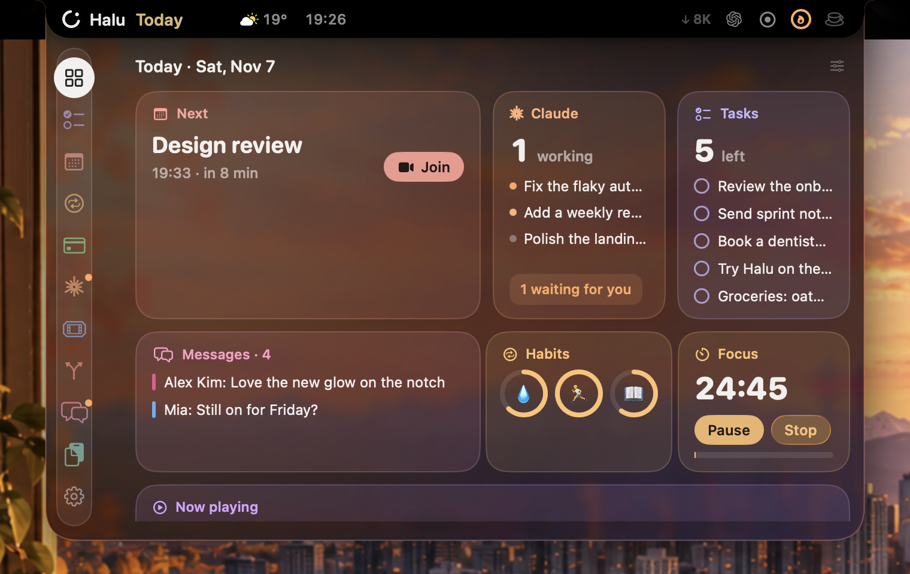
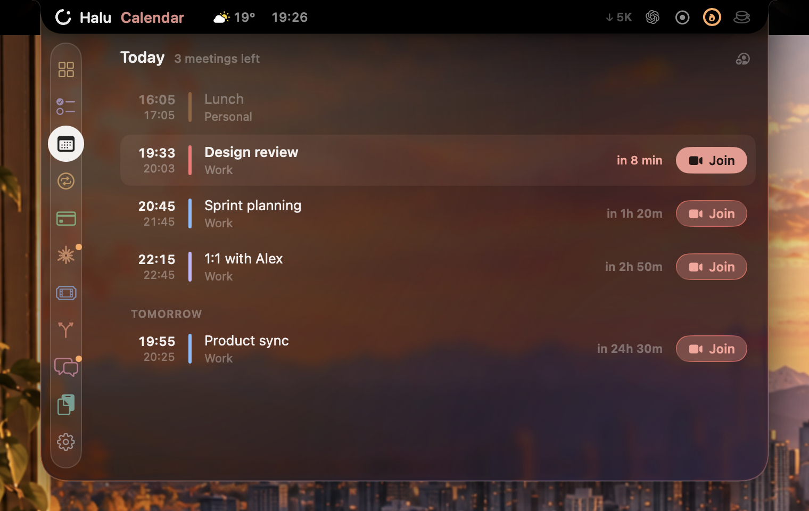
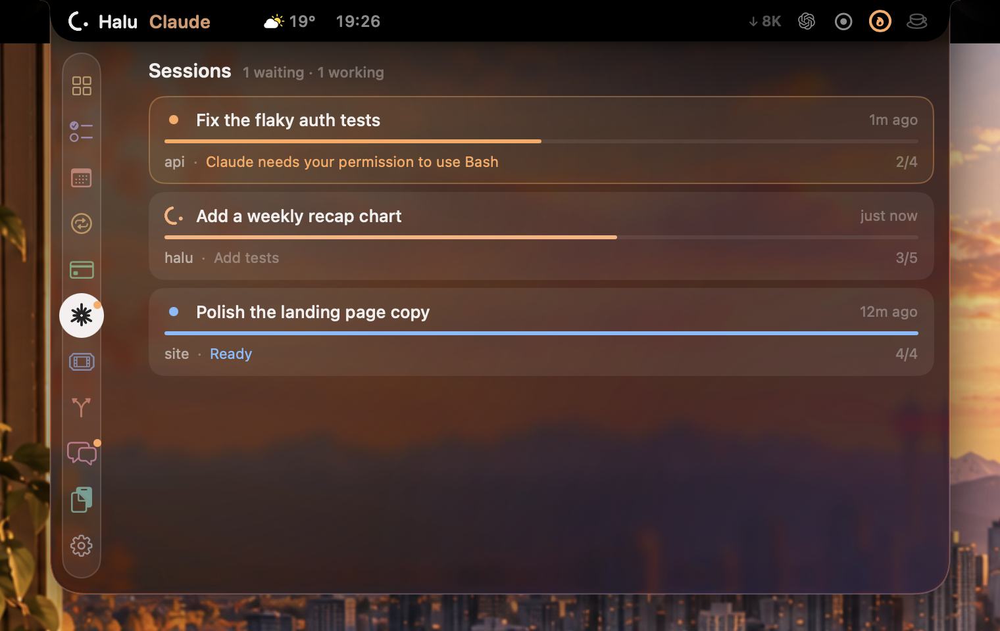
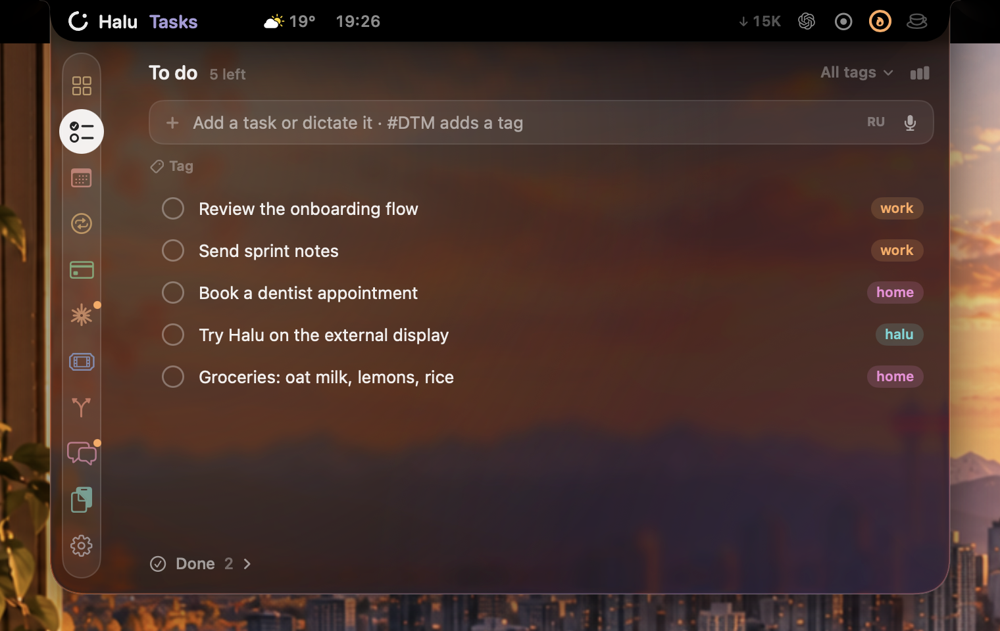
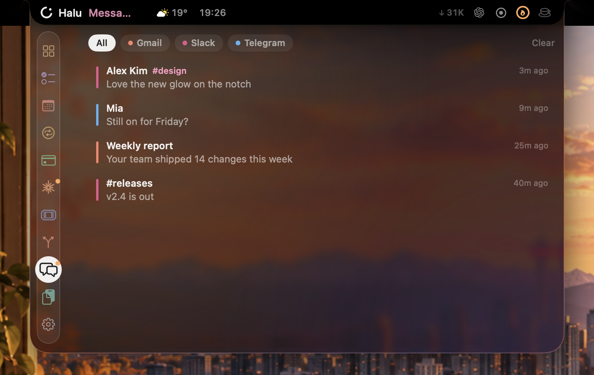
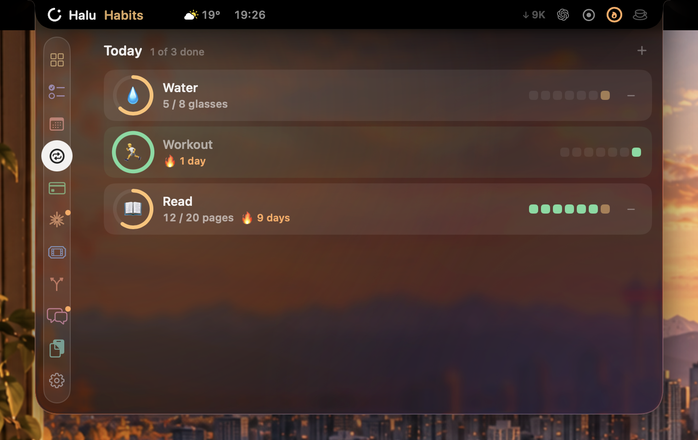
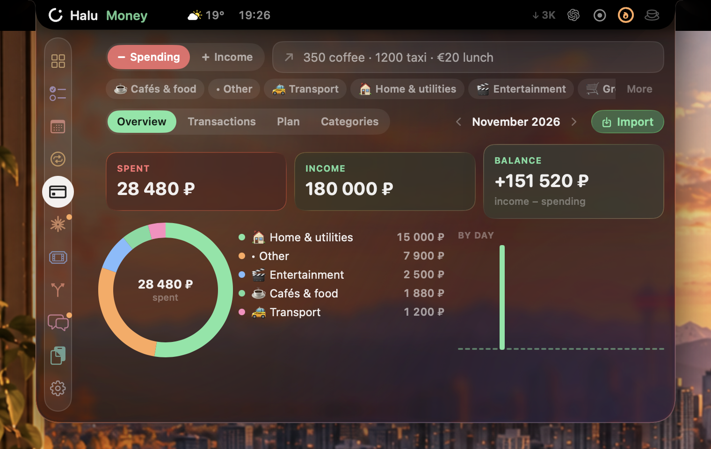
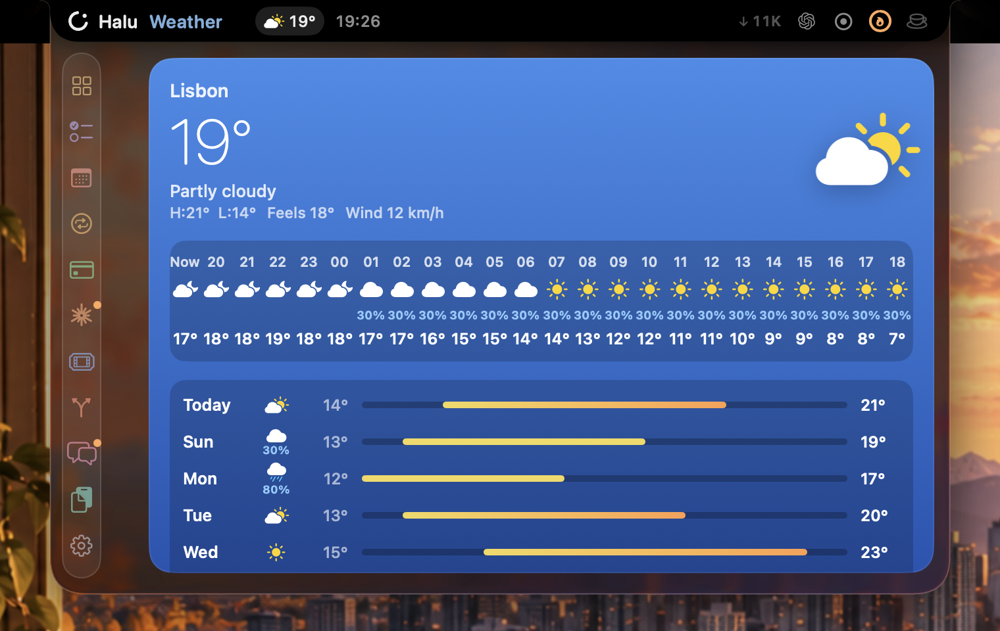
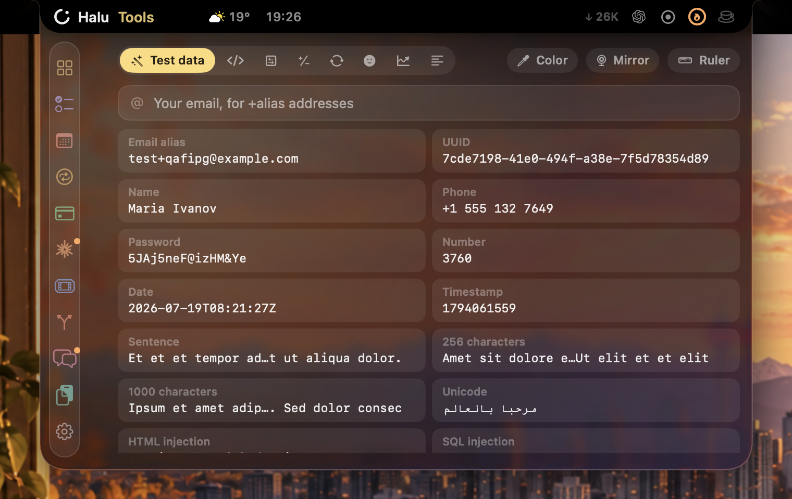

<p align="center">
  
</p>

<h1 align="center">Halu</h1>

<p align="center">A calm workspace that lives in your MacBook's notch.</p>

<p align="center">
  
</p>

Halu stays out of sight until you point at the notch. Then it opens into a small Liquid Glass panel with the things you reach for all day: your tasks, the next meeting, Claude Code sessions, unread messages. When something needs you, a soft orange mark glows beside the notch, so you know without opening anything. On an external display the top centre of the screen works as a virtual notch.

Native SwiftUI and AppKit, no dependencies. Your data stays on your Mac.

## Today

The home tab: one look at the day. The next meeting with **Join**, Claude sessions and who is waiting for you, open tasks you can tick off right on the tile, unread messages, habit rings, the focus timer and what's playing.

Press **Customize** to choose tiles, put them in order and make each one Small, Medium or Large (a quarter, half or a whole row). A live preview beside the list shows the result as you change it. Every tab with something worth a glance has a tile: Weather, System, GitLab, Jira, Clipboard, Notes, Money, Stands, Shortcuts and Translate too.

## Calendar



Today's and tomorrow's meetings from every calendar on your Mac, Google included (add the account in System Settings → Internet Accounts). One click joins Google Meet, Zoom, Teams or Webex, and Meet opens in the right Google account. Before a call the collapsed notch counts down with a glow that traces its outline; reminders pop out at 5 minutes, 1 minute and the start. Lunch isn't a meeting: you get one "Lunch time" note and a little snake on the notch while it lasts.

## Claude Code



Live status of every Claude Code session: working, waiting for you, your turn, done, with progress from the session's plan. When Claude asks for permission or asks a question, the card drops out of the notch and you answer right there (Allow, Always, Deny, or pick an option), or hand it back to the terminal. Your plan usage sits in the header.

Press **Connect** on the Claude tab once. Halu installs a small hook, `~/.claude/hooks/halu-hook`, and registers it in `~/.claude/settings.json` (your settings are backed up next to it, other hooks stay in place). The hook only records each session's status under `~/Library/Application Support/Halu`.

## Tasks, Messages, Habits, Money

<table>
  <tr>
    <td></td>
    <td></td>
  </tr>
  <tr>
    <td></td>
    <td></td>
  </tr>
</table>

- **Tasks.** One list for the day, with #tags, a tag filter and voice input (English or Russian). Checked tasks move to Done. A weekly recap counts tasks done, meetings, focus time and Claude sessions.
- **Messages.** Unread Slack, Telegram and Gmail in one feed, read from the browser tabs you already have open (using each site's own session, no tokens), plus other apps through macOS notifications. A thin colour mark shows the source; click to jump to the conversation.
- **Habits.** Yes/no habits and counters with a daily goal, rings, streaks and the last seven days.
- **Money.** Type "350 coffee" and the category is guessed (and learned when you change it). Import bank statements as CSV or Excel. Overview, transactions, a monthly plan and budgets.

## Weather and Tools

<table>
  <tr>
    <td></td>
    <td></td>
  </tr>
</table>

- **Weather.** A pill in the header; click it for the hourly and 7-day forecast (Open-Meteo, your location or a city you set).
- **Tools.** Test data that copies on click, a decoder for JWT, Base64, URLs, JSON and timestamps, Compare for text, JSON, PDF, Word and images, a calculator with units and currencies, a converter, emoji search and stock quotes. Plus a colour picker, a pixel ruler, a mirror and a teleprompter that is hidden from screen sharing.

## Everything else

- **Clipboard and Shelf.** Everything you copy, pinnable, plus saved snippets. Shelf collects new screenshots and recordings (searchable by the text in them) and any file you drop on the notch.
- **Translate.** English ↔ Russian, typed or dictated. ⌃⌥T translates the selected text anywhere.
- **Accounts.** Test accounts (service, login, password, notes) in an AES-GCM encrypted vault with its key in the Keychain. Import from Markdown, CSV or rows pasted from a table.
- **Stands.** Your test environments: Open opens the address and copies the login.
- **Jira and GitLab.** Your issues, the sprint or a status queue, with Start and any transition. Merge requests you own or review, new comments, pipeline status and a notice when a pipeline finishes.
- **Notes.** Your Apple Notes with search; plain-text notes are editable in Halu.
- **Media.** Whatever is playing, in any app or browser tab, with controls.
- **Shortcuts and System.** Run your macOS Shortcuts; CPU, memory, disk, battery and the busiest processes.
- **Chat.** ChatGPT in a panel from the header.
- **Header.** Download speed, Pomodoro, VPN switcher with ping, Keep Awake, screen recording.

## Make it yours

Settings (the gear) has four looks — **Aurora** (Liquid Glass with soft colour light, the default), Minimal, Playful and Neon — three panel sizes, the hover delay, and the tab list: turn tabs off (they stop their background work) and drag them into any order. Click the Halu logo to open the same tabs in a normal window. ⌃⌥Space opens Halu from anywhere.

## Requirements

- macOS 15 or later (Liquid Glass needs macOS 26; earlier versions get a frosted fill)
- Swift 6 toolchain (Xcode Command Line Tools are enough)

## Build and run

```bash
./scripts/build.sh --install
```

This builds `Halu.app`, copies it to `~/Applications` and starts it. Halu lives in the notch and the menu bar; it has no Dock icon.

Once, optionally: `./scripts/setup-signing.sh` creates a local signing certificate, so macOS keeps Halu's permissions across rebuilds.

The screenshots above come from `./scripts/screenshots.sh`, which runs a separate copy of Halu with made-up data (`--demo`): it never reads your calendars, sessions, messages or Keychain.

## Permissions

Halu asks only when a feature needs it:

| Feature | Permission |
|---|---|
| Calendar | Calendars |
| Shelf | Your screenshot folder |
| Voice input | Microphone and Speech Recognition |
| Notes, Messages in the browser, Media in the browser | Automation for Notes and your browser ("Allow JavaScript from Apple Events" in the browser) |
| Messages from other apps | Full Disk Access (macOS keeps notifications in a protected database) |
| Media keys, ⌃⌥T | Accessibility |

Tokens for Jira and GitLab are kept in one Keychain item. Nothing is sent anywhere except the services you connect.

## License

[MIT](LICENSE)
